# Ticket Flow

Микросервисная система бронирования и покупки билетов на мероприятия.

**Первая часть проекта — архитектура.** Реализация сервисов запланирована во второй части. Скрипты в репозитории обслуживают документацию, а не реализуют бизнес-процесс.

Покупатель выбирает место, получает временный резерв и оплачивает заказ. Система либо закрепляет место и выдаёт билет, либо освобождает резерв и завершает отмену платежа / возврат. Одно место нельзя продать дважды, повторный запрос не должен создавать повторное списание.

## Пять артефактов

| № | Артефакт | Содержание |
|---|---|---|
| 1 | [Карта контекстов](docs/01-context-map.md) | Объём MVP, границы трёх сервисов, данные и бизнес-правила |
| 2 | [C4 Container](docs/02-c4-containers.md) | Приложения, базы, брокер, внешняя платёжная система |
| 3 | [Контракты](docs/03-contracts.md) | Четыре OpenAPI и AsyncAPI, таблицы вызовов и сообщений |
| 4 | [Главный процесс](docs/04-main-process.md) | Состояния, успешная покупка и три сценария сбоя |
| 5 | [Архитектурные решения](docs/05-decisions.md) | Пять ADR с вариантами и последствиями |



## Как читать и обновлять

Начать с артефакта 1, затем читать по порядку. В Markdown есть схемы Mermaid; рядом приведены ссылки на SVG для просмотра и вставки в отчёт. Источники диаграмм находятся в `docs/diagrams/`; SVG и блоки Mermaid формируются из них одной командой.

```bash
npm ci
npm run docs:render
npm run docs:check
```

Для рендеринга нужен Chrome, который устанавливается вместе с Puppeteer. На Linux также нужны системные библиотеки Chrome. Параметры оформления и браузера находятся в `docs/tools/`. Поддерживается переменная `PUPPETEER_EXECUTABLE_PATH` для своего Chrome. Проверка контрактов не требует запущенных сервисов.

## Объём второй части

- Orders, Reservations и Payments: три независимо запускаемых приложения на Java / Spring Boot.
- PostgreSQL: отдельная логическая база и отдельный пользователь у каждого сервиса.
- RabbitMQ: события о результатах операций.
- Простой веб-интерфейс и имитатор внешнего платёжного провайдера.
- Docker Compose для локального демонстрационного окружения.

Имитатор должен воспроизводить отказ, задержку ответа, повторный callback и отмену / возврат. Документация описывает проектируемое поведение; работоспособность реализации будет проверяться во второй части.
