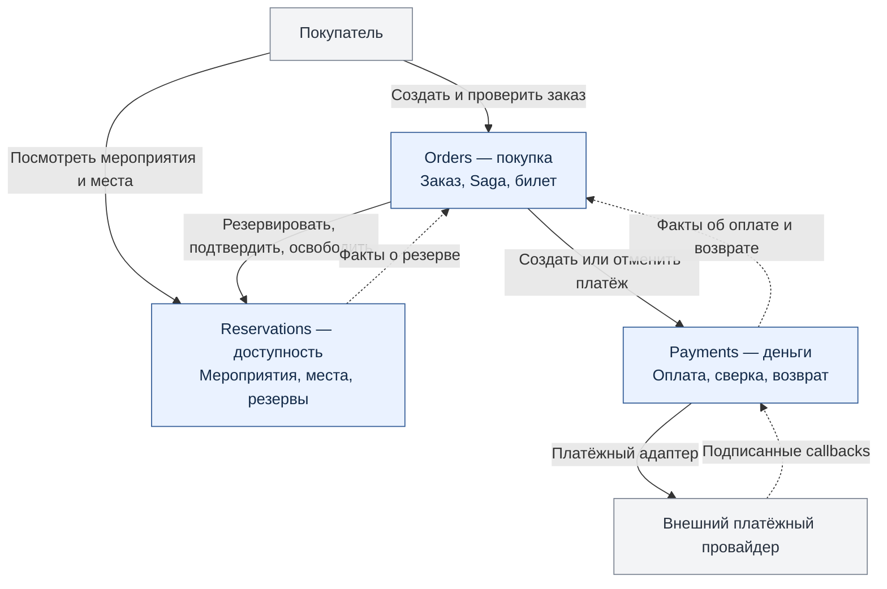

# 1. Карта контекстов

## Назначение и границы MVP

Ticket Flow продаёт билеты на мероприятия с пронумерованными местами. Главная операция — покупка одного места. Резерв действует **10 минут** по времени базы Reservations. Цена фиксируется при создании резерва; деньги передаются целым числом копеек, валюта MVP — RUB. Все технические даты — UTC в формате RFC 3339.

Покупатель видит мероприятия и места, создаёт заказ, переходит на страницу провайдера и проверяет результат в карточке заказа. Список свободных мест справочный: окончательное решение принимает атомарная операция резервирования. Возврат со страницы оплаты не доказывает успешное списание.

В MVP входят только заранее заведённые мероприятия, один билет в заказе, оплата, автоматическая отмена незавершённой покупки и полный возврат при невозможности выдать билет. Не входят корзина, скидки, перепродажа, пользовательский возврат уже выданного билета, отмена мероприятия, проход через турникет и отправка писем. Билет — уникальная запись, доступная в карточке подтверждённого заказа; генерация PDF не требуется.

## Почему выбранное разделение обосновано

Маленькую билетную систему можно реализовать монолитом. Учебная архитектура моделирует платформу с независимыми владельцами мест и финансовых операций, а также внешним провайдером, который не участвует в транзакции PostgreSQL. Согласование продажи и списания поэтому нельзя свести к одной локальной транзакции. Разделение позволяет независимо обеспечивать конкуренцию за места, финансовую сверку и управление покупкой. Дополнительные сервисы ради количества не выделяются.

## Схема

<!-- diagram:context-map -->

[Открыть изображение SVG](images/context-map.svg) · [Исходник Mermaid](diagrams/context-map.mmd)

## Orders — контекст покупки

**Ответственность:** заказ, состояния покупки, координация Saga и выдача билета. Orders принимает запрос покупателя, сохраняет идентификаторы будущих резерва и платежа, запускает шаги и доводит процесс до `CONFIRMED` либо `CANCELLED`. Данные: `orders`, `tickets`, `saga_steps`, `http_idempotency`, `inbox`, `outbox`. Этот сервис выделен потому, что жизненный цикл покупки и компенсации относится к заказу, а не к месту или банковской операции. Он хранит снимок цены и ссылки на чужие сущности, но не изменяет их таблицы. Состояние Saga и задания сохраняются в одной транзакции, чтобы перезапуск не терял следующий шаг.

## Reservations — контекст доступности мест

**Ответственность:** мероприятия, места, актуальная цена, резерв, срок действия и закрепление места за покупкой. Данные: `events`, `event_seats`, `reservations`, `http_idempotency`, `outbox`. Сервис выделен из-за собственного инварианта: на пару `(eventId, seatId)` может быть не более одного активного владельца — резерва `HELD` или продажи `CONFIRMED`. Он атомарно разрешает конкуренцию покупателей и гонку подтверждения с истечением срока. Каталог мероприятий остаётся здесь: отдельный каталог не нужен для объёма MVP. Только этот сервис решает, можно ли окончательно продать место.

## Payments — контекст денежных операций

**Ответственность:** попытка оплаты, взаимодействие с провайдером, сверка неизвестного результата, отмена и возврат. Данные: `payments`, `provider_operations`, `provider_callbacks`, `payment_jobs`, `http_idempotency`, `outbox`. Сервис выделен потому, что состояние денег определяется внешней системой, callbacks могут повторяться и приходить поздно, а возврат сам может требовать повторов. Он не знает правил распределения мест и не подтверждает заказ. Карточные данные вводятся на стороне провайдера и в Ticket Flow не сохраняются. На заказ разрешён один `paymentId`, на платёж — одна операция списания и одна операция полного возврата.

## Отношения контекстов

| Поставщик данных | Потребитель | Способ и смысл |
|---|---|---|
| Reservations | Веб-интерфейс | HTTP: список мероприятий и состояние мест |
| Orders | Веб-интерфейс | HTTP: создание и чтение собственного заказа, ссылка на оплату и билет |
| Reservations | Orders | HTTP-команды резервирования / подтверждения / освобождения; HTTP-чтение результата; события об изменении резерва |
| Payments | Orders | HTTP-команды создания / отмены оплаты; HTTP-чтение; события о финансовом результате |
| Провайдер | Payments | HTTP API, подписанные callbacks и сверка результата |
| Orders | Будущие интеграции | `OrderConfirmed`, `OrderCancelled`; в MVP обязательных подписчиков нет |

Orders использует публичные DTO поставщиков и не разделяет с ними ORM-модели. Провайдер скрыт за адаптером Payments: его статусы преобразуются в внутренние состояния. Общих таблиц и межсервисных внешних ключей нет.

## Инварианты

| № | Правило | Кто обеспечивает |
|---|---|---|
| I1 | Одно место не принадлежит двум активным резервам или продажам | Reservations: транзакция, блокировка строки места и ограничения уникальности |
| I2 | Повтор одного запроса не создаёт новый заказ, резерв, платёж или возврат | Сервис-владелец: стабильные ID, Idempotency-Key, уникальные ограничения |
| I3 | `CONFIRMED` допустим только при успешном списании и `CONFIRMED` у резерва этого заказа | Orders: проверки Saga, билет и конечный статус в одной транзакции |
| I4 | `CANCELLED` допустим только после освобождения / истечения резерва и окончательного финансового результата | Orders: барьер компенсации |
| I5 | При неизвестном результате денег или подтверждения места решение не угадывается | Payments / Orders: сверка и повтор с прежним ID |
| I6 | После начала компенсации заказ не возвращается к подтверждению | Orders: монотонный флаг `cancelRequested` и проверка версии заказа |
| I7 | Заказ, резерв и платёж связаны неизменяемыми ID; цена берётся из Reservations | Все сервисы: проверка `orderId`, суммы и валюты |

Для I4 допустимы финансовые результаты `FAILED`, `CANCELLED`, `REFUNDED`, а также доказанное отсутствие оплаты до запуска платёжного шага. Тайм-аут, `PENDING`, `CANCEL_PENDING`, `REFUND_PENDING` не являются завершённой компенсацией.

## Технические допущения

Покупатель определяется проверяемым JWT (`sub` — customerId), Orders возвращает только его заказы. В учебном окружении используется заранее выпущенный демонстрационный токен; отдельного сервиса аккаунтов нет. Внутренние HTTP API доступны только сервисам с сервисным Bearer-токеном; секреты задаются окружением. Каталог читается без авторизации. Тестовые данные мероприятий загружаются миграцией Reservations.
