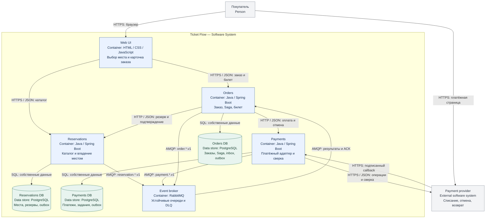

# 2. C4: уровень Container

**Область схемы:** система Ticket Flow. Container означает отдельно запускаемое приложение или хранилище, а не обязательно Docker-контейнер. Использована семантика C4 в Mermaid flowchart: явно указаны типы элементов, технологии, ответственность и протоколы связей.

<!-- diagram:c4-containers -->

[Открыть изображение SVG](images/c4-containers.svg) · [Исходник Mermaid](diagrams/c4-containers.mmd)

## Контейнеры

| Контейнер | Технология реализации | Ответственность |
|---|---|---|
| Web UI | HTML / CSS / JavaScript, статический сервер | Выбор места, создание заказа, переход к оплате, опрос результата |
| Orders | Java / Spring Boot | REST API покупателя, сохранённая Saga, формирование билета |
| Reservations | Java / Spring Boot | Каталог, конкурентные резервы, подтверждение и истечение срока |
| Payments | Java / Spring Boot | Платёжный адаптер, callbacks, сверка и возвраты |
| Orders DB | PostgreSQL | Заказы, билеты, задания Saga, inbox / outbox |
| Reservations DB | PostgreSQL | Места, резервы, outbox |
| Payments DB | PostgreSQL | Платежи, операции провайдера, задания, outbox |
| Event broker | RabbitMQ, AMQP 0-9-1 | Доставка событий в устойчивые очереди |
| Payment provider | Внешняя система; в демо — отдельный имитатор | Списание, отмена, возврат и финансовая истина |

Один экземпляр PostgreSQL с тремя базами и отдельными пользователями допустим в Docker Compose. Это не общая база данных: сервис не имеет прав на чужую базу. Кластеризацию и production HA схема не обещает. Потеря всего диска без резервной копии находится за пределами гарантии доставки сообщений.

## HTTP и события

Команды Reservations и Payments вызываются Orders по HTTP. Это уменьшает число типов сообщений и упрощает трассировку. Вызовы выполняет фоновый worker из сохранённых заданий: HTTP-тайм-аут не теряет команду и не означает её неуспех. Результаты изменений публикуются событиями; Orders может узнать результат и из HTTP-ответа, и из события. Обработка обоих источников идемпотентна.

Внутри Reservations работают очистка истёкших резервов и outbox relay; внутри Payments — сверка / отмена / возврат и outbox relay; внутри Orders — worker Saga, watchdog и outbox relay. Это фоновые задачи соответствующего сервиса, отдельными микросервисами они не являются.

## Брокер и гарантии

- Один durable topic exchange `ticket-flow.events`; ключ маршрутизации совпадает с каналом AsyncAPI.
- У Orders две durable quorum-очереди: `orders.reservations.q` (binding `reservation.*.v1`) и `orders.payments.q` (binding `payment.*.v1`). События заказов публикуются с `order.*.v1`; обязательной очереди для них в MVP нет.
- Persistent messages и publisher confirms. Relay помечает outbox-запись опубликованной только после confirm. Для обязательных маршрутов используется `mandatory`; unroutable-сообщение считается ошибкой публикации. Необязательные `order.*` допускают отсутствие подписчика.
- Доставка **at least once**. ACK — только после транзакции `inbox + изменение состояния + следующие задания`. Дубликат ACK-ается без повторного эффекта.
- Временная ошибка приводит к отложенному повтору. Необрабатываемое сообщение после 10 попыток направляется в DLQ; оно сохраняется для исправления и повторного запуска, возникает диагностический сигнал. Бизнес-отказ оплаты не является ошибкой доставки.
- Очереди и DLQ создаются до запуска relay. Перезапуск брокера с сохранённым томом не должен терять подтверждённые persistent-сообщения.

Корректность не зависит от глобального порядка событий. `aggregateVersion` помогает обнаруживать старые снимки, но обработчик не отбрасывает финансовый факт только потому, что увидел более новую версию. При пробеле, противоречии или неожиданном состоянии он читает актуальный ресурс и пересчитывает следующий шаг.

## Демонстрационное окружение второй части

Docker Compose: три сервиса, PostgreSQL с тремя базами, RabbitMQ с томом, статический UI и имитатор оплаты. Браузер обращается к публичным API по разрешённым origin; внутренние API закрыты от браузера. API Gateway, Kubernetes, Redis, отдельный сервис уведомлений и отдельный сервис авторизации для данного MVP не требуются.

Локально допустим HTTP; на внешней границе развёрнутой системы — HTTPS. Callback подписывается провайдером. На уровне эксплуатации нужны структурированные логи по `orderId` / `correlationId`, размер outbox, возраст незавершённой Saga и число ожидающих возврата платежей. Это требования второй части, готового мониторинга в первой части нет.
