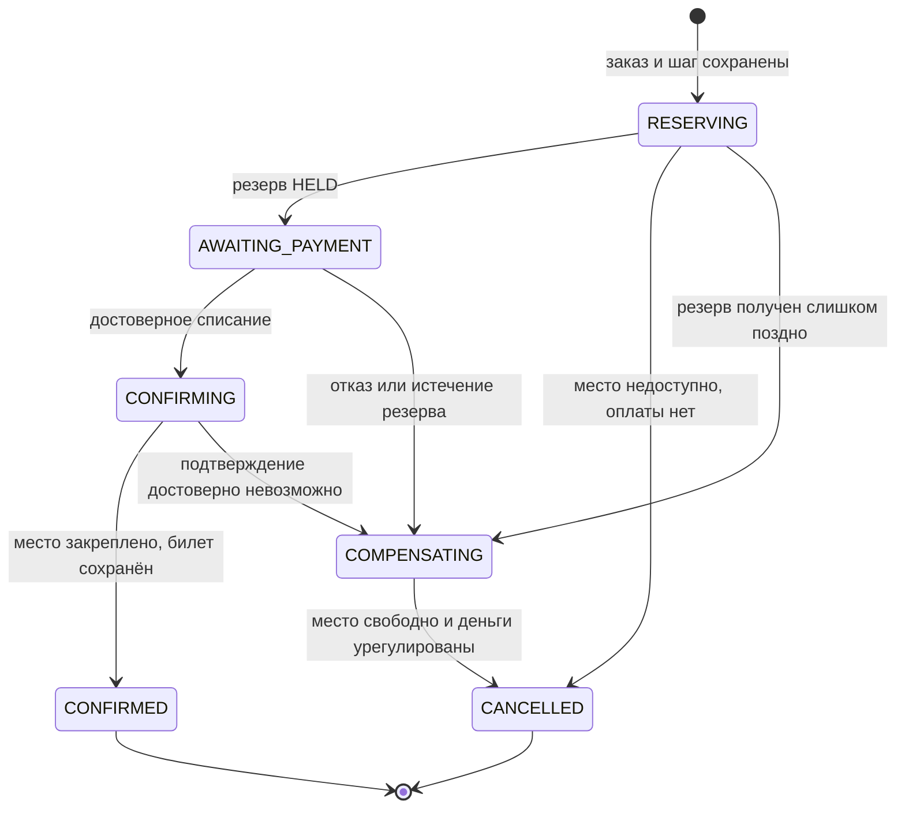
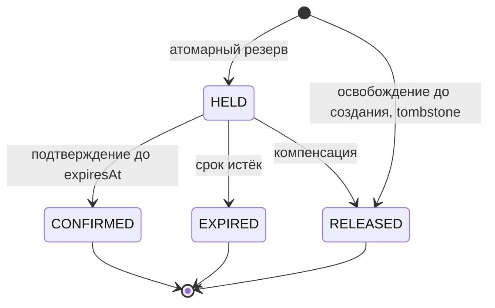
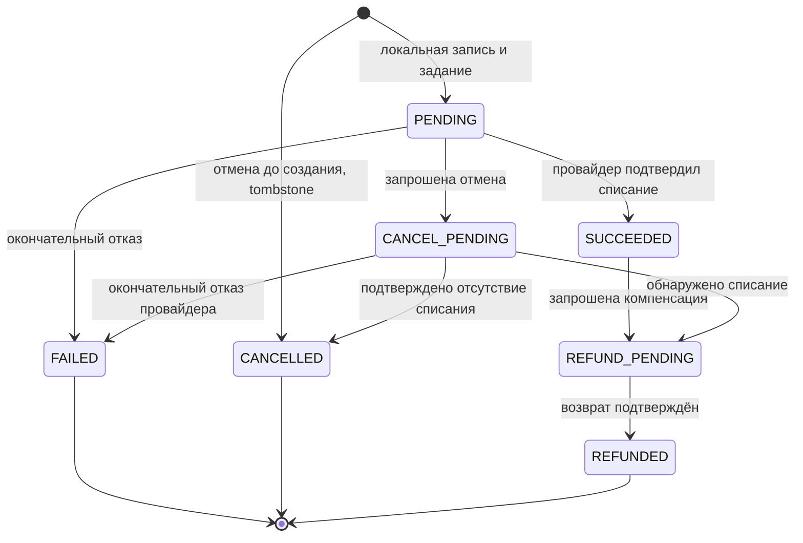
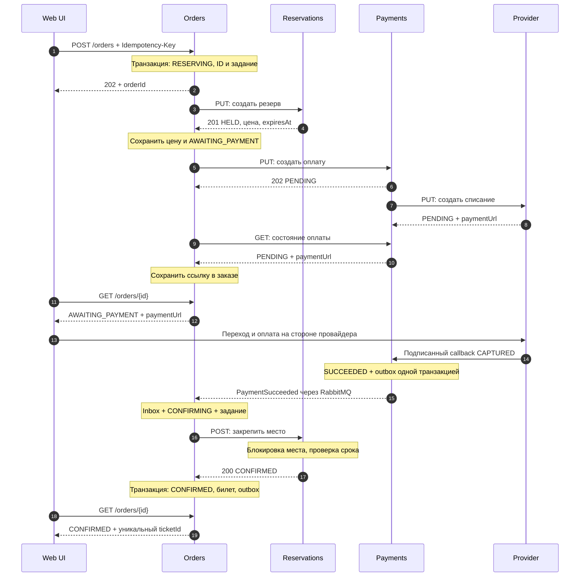
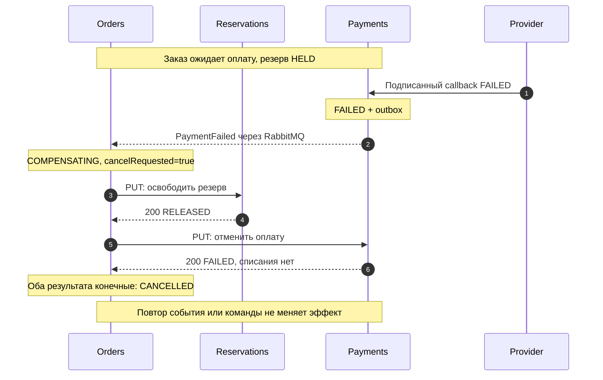
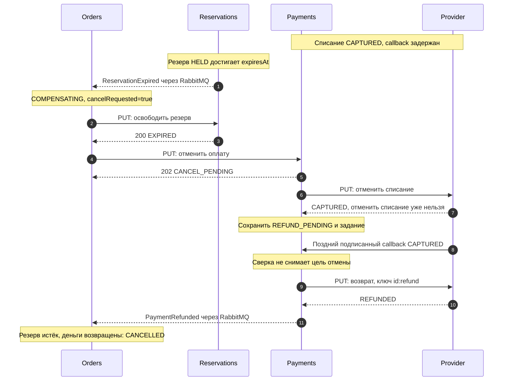
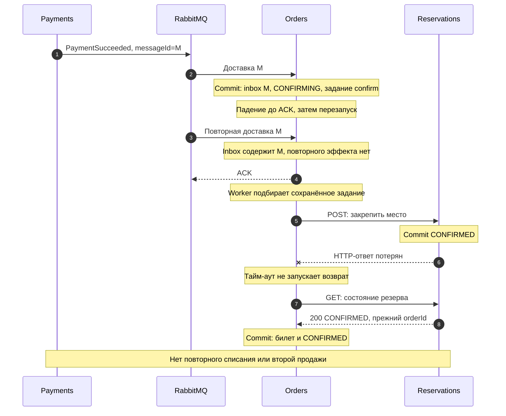

# 4. Главный процесс: покупка билета

## Правила координации

Orders — оркестратор. Его состояние, входящие события и следующий шаг записываются транзакционно. HTTP-команды выполняются из `saga_steps`; после перезапуска worker продолжает их с теми же ID и ключами. Один заказ обрабатывается с optimistic lock по версии; фоновые задания имеют lease. Внешний вызов не держит транзакцию базы открытой. Устаревший worker не может перезаписать новый статус, а его позднюю команду останавливает состояние целевого ресурса.

Длительность резерва — 10 минут. Reservations проверяет срок по времени своей БД; наступление срока не зависит от своевременного запуска cleanup worker. Тайм-аут HTTP не является ни отказом платежа, ни отказом подтверждения места. Сначала выполняется чтение результата / повтор с прежним ID.

При переходе к `COMPENSATING` сохраняется необратимая цель `cancelRequested=true`. Даже поздний `PaymentSucceeded` после этого ведёт к отмене / возврату, а не к подтверждению места. Но если результат ранее начатого подтверждения неизвестен, Orders сначала разрешает эту неопределённость: уже `CONFIRMED` резерв приводит к завершению успешного заказа. Компенсация начинается только после достоверного отказа подтверждения или до запуска этого шага.

## Состояния

### Заказ

<!-- diagram:order-states -->

[SVG](images/order-states.svg) · [Mermaid](diagrams/order-states.mmd)

| Состояние | Смысл и следующий шаг |
|---|---|
| RESERVING | Заказ принят; создать / выяснить результат резерва |
| AWAITING_PAYMENT | Резерв получен; создать оплату, получить ссылку, ждать или сверять результат |
| CONFIRMING | Списание доказано; закрепить место или выяснить итог уже посланного подтверждения |
| COMPENSATING | Освободить резерв, отменить оплату либо выполнить полный возврат |
| CONFIRMED | Место закреплено и билет сохранён; успешное конечное состояние |
| CANCELLED | Все нужные компенсации доказанно завершены; конечное состояние |

Недоступность места на первом шаге даёт прямой переход `RESERVING → CANCELLED`, если достоверно известно, что этот заказ не получил резерв и платёжный шаг не начинался. Если результат резервирования неизвестен, сначала читаем / повторяем запрос, затем при необходимости освобождаем его.

### Резерв

<!-- diagram:reservation-states -->

[SVG](images/reservation-states.svg) · [Mermaid](diagrams/reservation-states.mmd)

`HELD` занимает место до срока. `CONFIRMED` закрепляет его окончательно. `RELEASED` и `EXPIRED` не занимают место. Все команды и cleanup блокируют одну строку места; одновременно подтвердить и освободить один резерв нельзя. При точном равенстве `now == expiresAt` подтверждение уже запрещено. Повторный create не продлевает резерв и не оживляет конечное состояние.

### Платёж

<!-- diagram:payment-states -->

[SVG](images/payment-states.svg) · [Mermaid](diagrams/payment-states.mmd)

`PENDING` включает неизвестный результат обращения к провайдеру. `SUCCEEDED` означает подтверждённое списание. `CANCEL_PENDING` означает, что отмена запрошена, но отсутствие списания ещё не доказано. Если списание обнаружено при цели отмены, состояние становится `REFUND_PENDING`. `FAILED`, `CANCELLED`, `REFUNDED` — конечные финансовые результаты. `SUCCEEDED` окончателен для успешной покупки, но при компенсации допускает возврат.

Callbacks не присваивают статус вслепую. Payments проверяет подпись, уникальность callbackId, соответствие ID / суммы / валюты и версию провайдера; при конфликте читает текущее состояние провайдера. `CAPTURED` после `REFUNDED` не отменяет возврат. История финансовых фактов сохраняется отдельно от текущего статуса.

## Успешная покупка

В sequence-диаграммах события показаны пунктиром между отправителем и получателем с подписью «через RabbitMQ». Сам брокер опущен для читаемости, кроме сценария восстановления. HTTP-ответы также пунктирные, но явно имеют код / состояние. HTTP-действия сокращены для читаемости; полные пути приведены в таблице контрактов и OpenAPI.

<!-- diagram:sequence-success -->

[SVG](images/sequence-success.svg) · [Mermaid](diagrams/sequence-success.mmd)

1. UI передаёт только `eventId`, `seatId` и ключ запроса. Orders получает `customerId` из JWT, создаёт `orderId`, `reservationId`, `paymentId`, сохраняет заказ и задание; возвращает 202.
2. Reservations резервирует место атомарно и возвращает цену / RUB / срок. Orders сохраняет их снимок. Повтор того же заказа не меняет цену и срок.
3. Payments сохраняет платёж и задание провайдеру. URL появляется после выполнения этого задания; Orders получает его при сверке и сохраняет в своём read model. GET заказа читает собственную БД, без скрытого синхронного fan-out.
4. Покупатель оплачивает на стороне провайдера. Только подтверждённый финансовый факт запускает закрепление места. Если callback потерялся, тот же факт находит worker сверки.
5. Reservations проверяет владельца и срок и фиксирует `CONFIRMED`. Только после этого Orders в одной транзакции создаёт уникальный `ticketId`, переводит заказ в `CONFIRMED` и пишет `OrderConfirmed` в outbox.

**Постусловия:** одно место закреплено за данным заказом, одно списание на `paymentId`, один билет на `orderId`. Временное расхождение состояний возможно до обработки сообщений, но не допускает повторного эффекта.

## Сбой 1. Отказ оплаты после резервирования

<!-- diagram:sequence-payment-failed -->

[SVG](images/sequence-payment-failed.svg) · [Mermaid](diagrams/sequence-payment-failed.mmd)

**Что ломается:** провайдер окончательно отклоняет списание. **Компенсация:** освобождение места; финансовый результат сверяется как `FAILED`. Возвращать деньги не требуется, поскольку списания нет. Если Reservations недоступен, заказ остаётся `COMPENSATING`, задание release повторяется; `CANCELLED` пока не публикуется.

**Постусловия:** резерв `RELEASED` либо уже `EXPIRED`, платёж `FAILED`, заказ `CANCELLED`, билета нет.

## Сбой 2. Списание есть, но резерв истёк

<!-- diagram:sequence-expired-and-refund -->

[SVG](images/sequence-expired-and-refund.svg) · [Mermaid](diagrams/sequence-expired-and-refund.mmd)

**Что ломается:** подтверждение оплаты задержалось до истечения резерва. Место могло стать доступно другому покупателю. **Компенсация:** не пытаться восстановить старый резерв; отменить платёж, а если списание уже произошло — вернуть полную сумму. Пример показывает CAPTURED до срока, но позднее обнаружение; тот же алгоритм работает, если списание фактически пришло позднее.

Пока возврат неизвестен или провайдер недоступен, остаются `REFUND_PENDING` и `COMPENSATING`. Повтор возврата использует прежний ключ. `PaymentSucceeded`, пришедший после начала компенсации, не переключает Saga обратно на продажу.

**Постусловия:** старый резерв `EXPIRED`, платёж `REFUNDED`, заказ `CANCELLED`, билета нет. Чужая новая бронь не затрагивается: release работает по старому `reservationId`, а не по одному `seatId`.

## Сбой 3. Падение после commit и потеря ответа подтверждения

<!-- diagram:sequence-crash-recovery -->

[SVG](images/sequence-crash-recovery.svg) · [Mermaid](diagrams/sequence-crash-recovery.mmd)

**Что ломается:** Orders падает после фиксации входящего факта и следующего шага, но до ACK. После восстановления ответ Reservations на подтверждение также может потеряться. **Восстановление:** брокер повторяет событие; inbox блокирует повторный эффект, сохранённое задание продолжает Saga. Неизвестный итог подтверждения разрешается GET / повтором той же команды. В показанном случае место уже закреплено, поэтому создаётся билет; компенсация не нужна.

Если падение случилось до commit, inbox и задание отсутствуют — повтор обрабатывается как первый. Если relay упал после публикации до отметки отправки, он повторяет тот же `messageId`. Если резерв к моменту первого фактического подтверждения успел истечь, следует отказ 409 и сценарий 2 с возвратом.

**Постусловия:** заказ `CONFIRMED`, один билет, один подтверждённый резерв, одно списание. Билет и конечный статус записываются одной транзакцией; уникальность `tickets.order_id` защищает повтор завершения.

## Таблица восстановления

| Неопределённость | Действие | Чего нельзя делать |
|---|---|---|
| Потерян ответ reserve | GET по прежнему ID или повтор create с прежним ключом | Создавать новый резерв для того же заказа |
| Потерян ответ create payment | GET / повтор с тем же paymentId | Начинать новое списание под новым ID |
| Платёж долго PENDING | Payments сверяет провайдера; при истечении резерва сохраняет цель отмены | Объявлять отсутствие списания по тайм-ауту |
| Потерян ответ confirm | GET резерва и повтор с тем же ключом | Возвращать деньги при возможно подтверждённом месте |
| Отмена раньше create | Сохранить tombstone; поздний create получает 409 | Восстанавливать отменённый ресурс |
| Провайдер не отвечает при refund | Сохранить REFUND_PENDING, повторить прежнюю операцию | Финализировать CANCELLED без подтверждения возврата |
| Брокер недоступен | Outbox остаётся в БД; relay повторяет после восстановления | Терять событие или объявлять новый бизнес-отказ |

## Повторы, сроки и эскалация

HTTP: connect timeout 2 секунды, общий timeout 5 секунд. Повтор временных ошибок: 1, 2, 4, 8, 16, затем до 30 секунд с jitter; соблюдать Retry-After. Бизнес-конфликты 409 не повторяются как временные ошибки: нужно прочитать ресурс и выбрать переход. Идемпотентный reserve / confirm при неопределённом результате разрешено повторить с исходным ключом.

Orders watchdog сканирует промежуточные заказы каждые 15 секунд, Payments — незавершённые операции каждые 15 секунд, cleanup Reservations — каждые 5 секунд. Эти значения — настройки демо, не обещание production SLA. Через 5 минут без прогресса выставляется `attentionRequired=true`; это не меняет бизнес-статус и не останавливает безопасную сверку. При восстановлении зависимостей и доступности фоновых workers процесс должен сойтись к конечному состоянию. При бесконечной недоступности внешней системы конечный срок не гарантируется.

В MVP заказы, ключи провайдера, inbox и tombstone не очищаются. Политика хранения для production должна быть согласована со сроком возможных повторов и финансового аудита.

## Проверка реализации во второй части

| Эксперимент | Ожидаемый результат |
|---|---|
| Два одновременных заказа на одно место | Только один HELD / CONFIRMED |
| Повтор POST с тем же ключом и телом | Тот же orderId; один платёж |
| Тот же ключ, другое место | 409; исходный заказ не меняется |
| Отказ оплаты | Место освобождено, билета нет |
| Задержать callback за expiresAt | Полный возврат; старый резерв не оживает |
| Остановить Orders между commit и ACK | Повтор события без повторного эффекта |
| Потерять HTTP-ответ после confirm | Чтение обнаруживает CONFIRMED, возврата нет |
| Остановить брокер после бизнес-commit | Outbox публикуется после восстановления |
| Повторить callbacks в обратном порядке | Статус денег не откатывается |
| Доставить cancel раньше create | Tombstone запрещает поздний запуск операции |

Это сценарии приёмки будущего кода. В первой части проверяются контракты, ссылки и воспроизводимость диаграмм; сами эксперименты ещё не выполнены.
